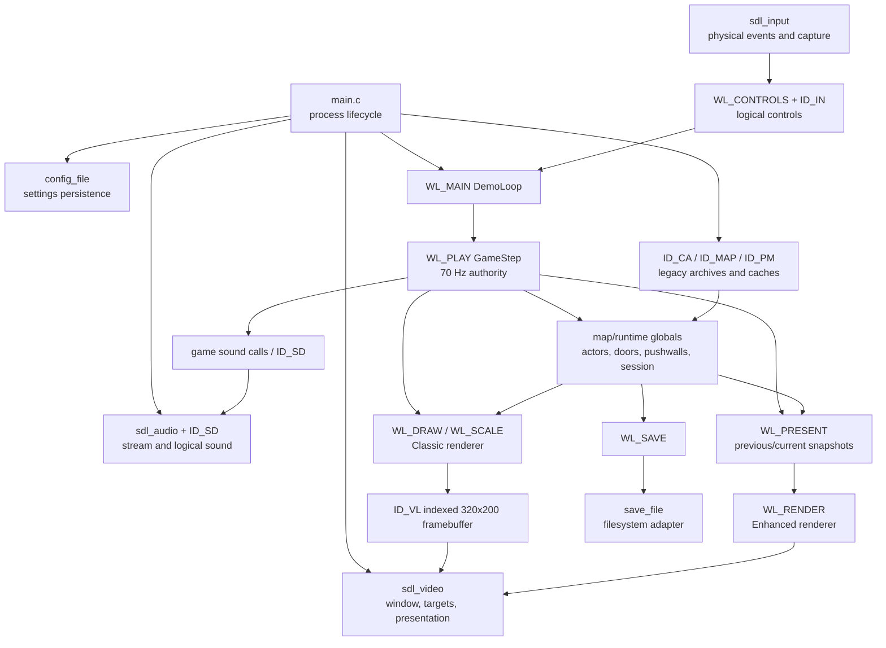
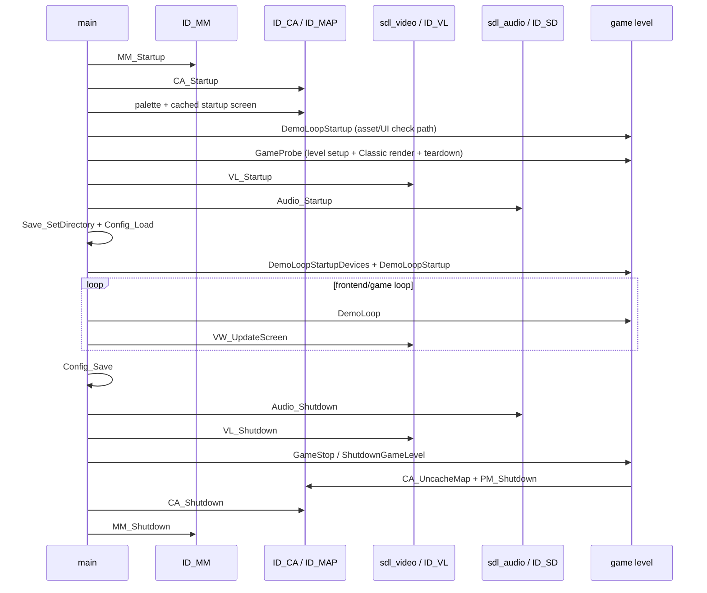
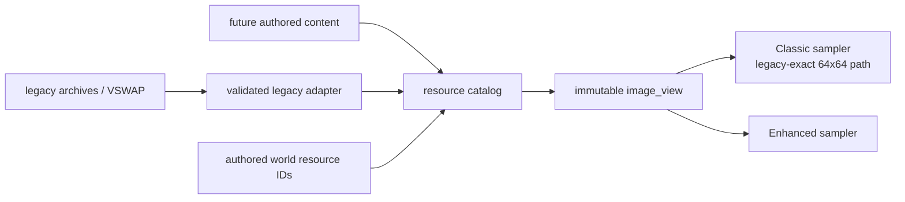

# R0.2 Architecture and ownership mapping

**Revision:** R0.2

**Branch:** `docs/revival-roadmap-and-validation`

**Status:** PASS
**Scope:** documentation and design only; no production C or asset changes

## Purpose

Record the architecture that exists in the inspected source, identify ownership
and lifecycle hazards that affect later milestones, and define the smallest
native-C boundaries needed for deterministic tests, variable-sized resources,
and the Workshop. This is a map and a contract for later revisions, not an
implementation commitment.

The principal finding is that platform isolation is already better than the
global variable count suggests. Most gameplay code is SDL-free and the test
suite already links it to only the filesystem adapters it needs. The difficult
boundary is world ownership: immutable legacy map planes, mutable session
arrays, actor pools, renderer bookkeeping, and save serialization jointly
describe one running level.

## Revision contract

### In scope

- Inspect current C call direction, initialization, shutdown, resource
  lifetime, global state, and test linkage.
- Map present ownership and identify concrete extraction seams.
- Describe Classic/Enhanced compatibility risks.
- Specify a minimal native-C authored-world editing interface, including
  validation, transactions, stable identities, undo/redo, and persistence
  boundaries, without implementing it.
- Describe a shared resource-image boundary that can later represent both
  legacy 64x64 images and 128x128 content.
- Assign required, optional, and deferred changes to R1-R6.
- Update the reusable source-inspection procedure.

### Out of scope

- C, build-system, fixture, archive, or asset changes.
- A new map format, PNG decoder, Workshop UI, or editor implementation.
- Removal of legacy globals, a renderer rewrite, ECS, scene graph, scripting,
  GPU migration, or multi-level/multi-storey world support.
- Completion claims for R0.3-R0.6 or later milestones.

### Prerequisites

- R0.1 baseline and its validation evidence.
- The source tree and tests at the R0.2 branch head.
- Private Wolfenstein data only for locally owned compatibility regression; no
  protected input or generated capture may enter source control.

## Current architecture

The arrows below mean a direct call or direct data dependency observed in the
source. They do not imply a planned abstraction.



Only `main.c` and platform implementation/header files include SDL directly.
Core test harnesses compile `src/engine/*.c` with `data_file.c` and
`save_file.c`, demonstrating a real, if informal, headless boundary. Logical
controls (`WL_CONTROLS`) and logical sound state (`ID_SD`) remain on the engine
side; SDL input translates physical state into controls, while the SDL audio
stream consumes copied PCM.

Key source anchors used for the map are:

- `main.c::main` owns process startup, the outer loop, configuration save, and
  ordered shutdown. `WL_MAIN.c::DemoLoop` owns frontend/game-loop selection.
- `WL_PLAY.c::GameStep` is the authoritative fixed-step entry. Normal play
  advances one 70 Hz tic; demo paths may process four, with `MAXTICS` bounding
  catch-up. It drives controls, doors, pushwalls, actors, sound requests,
  rendering, and presentation capture.
- `WL_GAME.c::SetupGameLevel`/`ShutdownGameLevel`,
  `ID_CA.c::CA_CacheMap`, and `ID_MAP.c::CA_ReadMap` bridge cached legacy
  planes into the running level.
- `WL_AGENT.c::TryMove`/`ClipMove` and `actorat`/`tilemap` implement player
  collision; actor/state code performs its own grid occupancy checks.
- `WL_DRAW.c::CastRay` and `ThreeDRefresh` are the Classic ray/render path;
  `WL_DRAW.c::WL_RenderRayWorld` is the read-only ray-scene seam consumed by
  `WL_RENDER.c` for Enhanced rendering.
- `WL_OBJECT.c::InitObjects`, `GetNewActor`, `SpawnActor`, and `RemoveActor`
  own the fixed actor pool and its linked/free lists. `WL_ACT1.c` owns doors
  and live pushwall behavior.
- `WL_SAVE.c` serializes live game state through `save_file.c`;
  `config_file.c` persists user configuration separately.

### Runtime ownership and call direction

| State/resource | Declared/owned by | Initialized or reset by | Principal users and writers | Consequence |
|---|---|---|---|---|
| `gamestate` | `WL_OBJECT.c` | game/session startup and save/load paths | gameplay, intermission, campaign, rendering, UI, save | Session authority is globally reachable; tests must reset it explicitly. |
| `player` | `WL_GAME.c` | level setup/player spawn | agents, actors, combat, state machine, renderers, save | A live actor pointer is not an authored player-start definition. |
| `tilemap`, `areaMap`, `areabyplayer`, `spotvis` | `WL_GAME.c` / `WL_OBJECT.c` | `SetupGameLevel` derives them from cached map planes | collision, AI, ray casting, area reachability, save | Durable map cells and transient visibility/navigation data are interleaved at module scope. |
| `doorobjlist`, `doornum` | `WL_GAME.c` | level setup and door spawning | door simulation, rendering, save | Authored door placement and live door position/action need distinct representations. |
| pushwall position/direction/state | `WL_ACT1.c` | reset/setup and pushwall actions | simulation, render/save | Live motion must not be written back into authored map planes. Current code deliberately avoids doing so. |
| `objlist`, `actorat`, actor free/used lists | `WL_OBJECT.c` | `InitObjects`, spawn/remove helpers | AI, combat, collision, state, save, presentation | Slot/pointer identity is a bounded runtime-pool identity, not a stable authored object ID. |
| `statobjlist` and static counts | `WL_OBJECT.c` | level scan/spawn | gameplay, renderers, save | Static content and consumed/transient state share the runtime registry. |
| cached `maptype` planes | `ID_MAP.c` / `ID_CA` | `CA_CacheMap`; released by `CA_UncacheMap` | setup and restart source | Three fixed 64x64 legacy planes are borrowed cached input, not the mutable running world. |
| page file and page cache | `ID_PM.c` | `PM_Startup` / `PM_Shutdown` | both renderers and sound/resource code | Returned page pointers are borrowed and invalid after cache shutdown. |
| graphics chunks, sizes, picture table | `ID_CA.c` | `CA_Startup` / `CA_Shutdown` | UI, menus, Classic presentation | Cache manager owns bytes; consumers must not free or retain them across shutdown. |
| framebuffer and palette | `ID_VL.c` | CA/VL startup and palette calls | Classic renderer, UI, SDL video | Classic remains indexed 320x200; platform presentation owns conversion/display. |
| view geometry, ray/scale scratch | `WL_VIEW.c`, `WL_DRAW.c`, `WL_SCALE.c` | view setup/build tables | Classic renderer | Rendering is not re-entrant and is coupled to global dimensions and scratch state. |
| presentation snapshots | `WL_PRESENT.c` | reset/capture on game steps | Enhanced renderer/interpolation | This is a useful read-only scene seam, but it copies runtime arrays and is not an authored world. |
| window, SDL renderer/texture, wide targets, RGBA staging | `sdl_video.c` | `VL_Startup` / `VL_Shutdown` | platform presentation and Enhanced path | SDL resources stay below the platform boundary. |
| physical input/focus/capture | `sdl_input.c` | input startup/event processing | translation to `WL_CONTROLS`/`ID_IN` | Headless tests should inject logical controls, not synthesize SDL events. |
| logical audio resources/chip state | `ID_SD.c` | sound startup/shutdown | game sound requests and SDL audio bridge | Deterministic gameplay should assert sound requests/state without requiring a device. |
| SDL audio stream | `sdl_audio.c` | `Audio_Startup` / `Audio_Shutdown` | callback/queue bridge | Stream/device lifetime belongs to the platform, not the simulation. |
| menu/frontend/control state | `WL_MAIN.c` and menu modules | demo-loop/menu entry points | UI and platform video callbacks | UI state is process-level mutable state and must not become the Workshop's world model. |
| config/save data | `config_file.c`, `WL_SAVE.c` | explicit load/save | settings or runtime serialization | Existing file adapters are reusable patterns, but authored maps need versioning and atomic writes of their own. |

Workshop and headless access decisions for those same groups are explicit:

| State group | Workshop access | Headless manipulation today |
|---|---|---|
| Session (`gamestate`) and live `player` | No direct access. Playtest receives a derived session; player start is an authored value. | Possible but fragile: harness must initialize/reset globals in the correct order. |
| Authored tiles, doors, objects, player start | Yes, through validated world queries and transactions only. | No canonical owner yet; tests can construct legacy/runtime arrays directly but should not make that the new API. |
| Reachability, visibility, live doors/pushwalls | Read-only diagnostics at most; never persisted as authored content. | Yes after complete level/object reset; isolation is informal. |
| Actor/static pools and `actorat` | No. Session builder/spawn helpers translate authored definitions. | Yes through existing spawn/reset helpers; raw slot mutation is unsafe. |
| Legacy map planes and CA/PM/graphics caches | Import/preview through adapters and catalog IDs, never borrowed cache pointers. | Yes with archive fixtures and matched startup/shutdown; pointers cannot outlive caches. |
| Classic/Enhanced renderer and presentation buffers | Workshop rendering may consume immutable queries/snapshots; it must not own them as world state. | CPU render seams are headless; actual display/presentation needs SDL harnesses. |
| Input and audio | Workshop controller consumes logical controls and emits logical sound requests; neither belongs to the world. | Logical controls/sound are testable without a device; physical input and stream integration require SDL. |
| UI/config/save state | UI/config are outside the world. Authored persistence uses a versioned world codec plus platform file adapter. | Current save/config tests exist, but no authored-map persistence API exists. |

`MM` owns allocations registered through its memory manager; the archive/cache
modules own the buffers they expose. In all later interfaces, ownership must be
spelled out as owned, borrowed for a call, or borrowed until catalog/world
destruction. No new API should return an unqualified raw pointer with a hidden
cache lifetime.

### Initialization and shutdown



`SetupGameLevel` caches the legacy map and page file, resets object registries,
copies/derives runtime tiles, locates player/doors/objects from the info plane,
validates enclosure and resource references, and builds view tables.
`ShutdownGameLevel` and `CA_Shutdown` have overlapping defensive cleanup. That
is useful for present error paths but makes lifecycle ownership implicit.
`GameProbe` is not a pure data probe: it constructs a level and invokes the
Classic renderer before tearing it down.

The later world/catalog design should make partial construction explicit:
initialize output pointers to null, unwind only acquired stages, make destroy
safe on null/partial objects, and never require SDL to validate authored data.

## Rendering and resource boundaries

### What exists

- Classic ray casting selects a wall page and a 0-63 source column, then fixed
  scaler code samples 64x64 indexed data into the 320x200 framebuffer.
- Enhanced rendering uses the same gameplay intersections and fixed 4096-byte
  wall/sprite assumptions, but renders the world to the platform-owned wide
  target. UI/HUD presentation preserves the original 4:3 indexed surface.
- Legacy sprite decoding also assumes a 4096-pixel image plus opacity data.
- `WL_PRESENT` gives Enhanced rendering previous/current copies of tiles,
  doors, statics, and actors for interpolation.
- Enhanced rendering is intended to read snapshots without changing
  simulation state. Classic rendering still updates `spotvis` and actor
  visible/active bookkeeping and can collect a visible bonus outside its pause
  guard. Therefore "render" is not currently a universally read-only call.

### Minimal shared image contract for R2

Both renderers should consume one immutable image description rather than gain
separate 128x128 loaders. The exact name belongs in the R2 contract; the
minimum semantics are:

```c
typedef uint32_t resource_id;
typedef uint32_t palette_id;

typedef enum resource_role {
    RESOURCE_WALL,
    RESOURCE_SPRITE,
    RESOURCE_UI
} resource_role;

typedef struct image_view {
    resource_id id;
    resource_role role;
    uint16_t width;
    uint16_t height;
    uint32_t stride;
    const uint8_t *indices;  /* borrowed, immutable indexed pixels */
    const uint8_t *opacity;  /* borrowed; NULL means role-defined opaque */
    palette_id palette;
    int16_t pivot_x;
    int16_t pivot_y;
    uint32_t world_scale_num;
    uint32_t world_scale_den;
} image_view;

bool resource_image(const resource_catalog *catalog,
                    resource_id id,
                    image_view *out,
                    resource_error *error);
```

The catalog owns bytes and the view borrows them until catalog destruction.
Dimensions, stride, multiplication, pivot, scale denominator, and maximum
decoded bytes require bounded validation before a view is published. Opacity
is explicit because palette index zero is not a safe universal transparency
rule.

The legacy VSWAP adapter should expose existing pages as 64x64 views and retain
the exact Classic sampling route. Rays should eventually carry a normalized or
fixed-point texture coordinate which each sampler maps to `width`, rather than
embedding 63 masks throughout casting/scaling. R2 must first prove pixel/hash
parity for the 64x64 adapter, then add 128x128 cases and malformed-dimension
tests. The descriptor also covers HUD and weapon sprites: Classic continues to
composite their indexed legacy views on the 320x200 surface, while Enhanced
may scale the same logical resource according to explicit pivot/world or UI
scale metadata. Workshop previews resolve the same IDs through the same
catalog. PNG alpha must be decoded into explicit opacity rather than assuming
palette index zero; actual PNG decoding, true-colour rendering, filtering,
atlases, and GPU upload are separate choices and are deferred.



## Proposed authored-world boundary

### Ownership model

One native-C world component is justified because durable map content needs a
single owner independent of SDL, UI callbacks, runtime actor slots, and cache
pointers. It owns authored cells, player start, doors, objects, stable IDs, and
the generation used for transaction conflict checks. The running game builds a
bounded session representation from it. Door motion, visibility, actor state,
collected items, and pushwall travel remain session state; they must not mutate
the authored definition.

The legacy loader becomes an adapter into this model only when its milestone
approves that change. Workshop and future loaders then use the same validation
and mutation operations. Gameplay consumes a validated world; it does not call
editor operations to move live actors or doors.

### Minimum C11 interface semantics

The following is a semantic sketch, not a frozen header:

```c
typedef struct world world;
typedef struct world_edit world_edit;
typedef uint64_t world_object_id;

typedef enum world_status {
    WORLD_OK,
    WORLD_INVALID_ARGUMENT,
    WORLD_OUT_OF_BOUNDS,
    WORLD_LIMIT_EXCEEDED,
    WORLD_CONFLICT,
    WORLD_INVALID_CONTENT,
    WORLD_IO_ERROR,
    WORLD_NO_MEMORY
} world_status;

world_status world_create(const world_limits *limits, world **out,
                          world_error *error);
void world_destroy(world **value);
world_status world_validate(const world *value,
                            const resource_catalog *resources,
                            world_report *report);

world_status world_get_cell(const world *value, uint16_t x, uint16_t y,
                            world_cell *out);
world_status world_get_object(const world *value, world_object_id id,
                              world_object *out);

world_status world_edit_begin(world *value, world_edit **out,
                              world_error *error);
world_status world_edit_set_wall(world_edit *edit, uint16_t x, uint16_t y,
                                 resource_id wall, world_error *error);
world_status world_edit_clear_wall(world_edit *edit, uint16_t x, uint16_t y,
                                   world_error *error);
world_status world_edit_place_door(world_edit *edit, uint16_t x, uint16_t y,
                                   const world_door *door, world_error *error);
world_status world_edit_remove_door(world_edit *edit, uint16_t x, uint16_t y,
                                    world_error *error);
world_status world_edit_place_object(world_edit *edit,
                                     const world_object *object,
                                     world_object_id *out_id,
                                     world_error *error);
world_status world_edit_remove_object(world_edit *edit, world_object_id id,
                                      world_error *error);
world_status world_edit_set_player_start(world_edit *edit,
                                         const world_player_start *start,
                                         world_error *error);
world_status world_edit_commit(world_edit **edit, world_report *report);
void world_edit_cancel(world_edit **edit);

world_status world_undo(world *value, world_report *report);
world_status world_redo(world *value, world_report *report);
world_status world_decode(world_reader *input, world **out,
                          world_report *report);
world_status world_encode(const world *value, world_writer *output,
                          world_report *report);
```

Required behavior:

- Coordinates and counts are checked before indexing or allocation. Initial
  compatibility remains a single bounded 64x64 plane unless a later contract
  explicitly expands it.
- Getters copy small value records or return documented immutable borrows; no
  caller receives mutable storage.
- An edit records a bounded, deterministic delta and its base generation.
  Commit validates the complete candidate and either publishes all changes or
  none. A stale generation returns `WORLD_CONFLICT`.
- Initially one edit may be active per world. This avoids unneeded locking and
  is sufficient for the single-threaded Workshop.
- Stable object IDs are monotonic within a world history and are not runtime
  actor pointers or reusable array indices. Save/load preserves them.
- Undo/redo stores committed inverse/forward deltas in an explicitly bounded
  history. A new commit after undo discards the redo tail. Allocation failure
  or failed validation leaves the world and history unchanged.
- Validation reports machine-readable status, coordinate/object/resource
  context, and bounded diagnostics. It checks enclosure, player-start
  cardinality, tile/door/object conflicts, object and resource references,
  capacity, and format/version constraints.
- Buffer/reader/writer interfaces keep core serialization independent of SDL
  and filesystem policy. R6 supplies an atomic file adapter (temporary file,
  flush/close, replace, recovery/error reporting) and round-trip tests.
- Destruction accepts null/partial values. No operation invokes UI callbacks,
  reads input, renders, or silently repairs invalid content.

This interface deliberately does not expose `tilemap`, `actorat`, map-plane
pointers, or renderer structs. A later session builder is the narrow seam that
translates a validated world into today's bounded runtime arrays. That permits
incremental migration without requiring a rewrite of actor logic.

## Headless test boundaries

### Proven today

`tests/test_engine.py` builds CPU harnesses from engine sources with only the
platform-neutral data/save file adapters. Current non-SDL harnesses cover
engine logic, game behavior, combat, bosses, campaign/finale, demo traces,
frame clock, aspect/render targets, native render hashes, save, UI, and
intermission behavior. SDL harnesses separately cover actual video/audio,
presentation, loading, frontend/menu, controls, and full Classic/Enhanced
paths.

The boundary is usable but state isolation is informal: harnesses manipulate
globals and depend on `InitObjects`, `GameStop`, and cache shutdown to restore
state. `WL_RenderRayWorld` and presentation snapshots are useful read-only
render seams. They are not substitutes for a world owner.

### Required evidence by revision

| Revision | Headless boundary and tests | SDL/visual boundary |
|---|---|---|
| R0.3 | Freeze deterministic behavior of existing global APIs: level query/collision/ray results, actor/door/pushwall ticks, restart/reset, logical control injection, and fixture diagnostics. Document complete reset order. Do not pre-implement the Workshop API. | None required except existing regression. |
| R0.4 | Use deterministic scenes/snapshots and fixed ticks to prepare comparisons. | Capture and compare actual Classic and Enhanced output at 4:3 and widescreen; retain human review where image tolerance cannot prove usability. |
| R2 | Test catalog ownership, legacy 64x64 parity, 128x128 addressing, opacity, invalid dimensions/stride/overflow/references, and partial-init cleanup without SDL. | Focused integration confirms both renderer paths consume the same validated views. |
| R4 | Test every world edit, validation error, transaction atomicity/conflict, stable ID, bounded undo/redo, allocation failure, and runtime-session build with no UI. | Workshop UI tests cover input/display only; authoring correctness remains in native headless tests. |
| R6 | Test versioning, malformed/truncated input, deterministic round trip, unknown resource IDs, write failure, atomic replacement/recovery, playtest-copy isolation, and return-to-editor state. | End-to-end Workshop/playtest usability and presentation remain SDL/human gates. |

R0.3 should add the smallest reset/fixture helpers needed to make existing
state deterministic before any ownership migration. That gives later
refactors a behavioral oracle and avoids changing architecture and expected
behavior in the same revision.

## Minimal milestone change map

| Milestone | Classification | Existing module/function and proposed minimum boundary | Why / dependency / risk | Verification before or with implementation |
|---|---|---|---|---|
| R1 | **Required** | Put stable content/resource identities in the approved manifest/catalog boundary before values reach current `ID_CA`, `ID_PM`, `ID_SD`, and `SetupGameLevel` lookups. | Prevent more hard-coded Wolf-specific archive indices while preserving licensed-data separation. Identity drift can break saves and legacy lookup. | Manifest validation and unchanged owned-data compatibility. |
| R1 | Optional | Add read-only diagnostics beside current CA/PM lookup diagnostics. | Useful for failures, but it must not become a second loader. | Deterministic textual output. |
| R2 | **Required** | Place one validated catalog/image-view boundary in front of `PM_GetPage`, Classic `CastRay`/scalers, Enhanced `WL_RenderRayWorld`, and sprite/HUD/weapon consumers. Keep a legacy adapter. | Enables 64 and 128 dimensions without split content systems. Risks are Classic pixel drift, overflow, opacity, pivot/scale, and cache lifetime. | Legacy hashes first, then 128/malformed/failure tests and both-renderer integration. |
| R2 | Deferred | Leave PNG decoding policy, true-colour pipeline, filtering, atlases, and GPU ownership outside the dimension-safe indexed descriptor revision. | None is required to remove fixed-dimension assumptions safely. | Later approved contract. |
| R3 | **Required** | Bind new `WL_AGENT`/`WL_ACT*`/`WL_COMBAT` weapons, enemies, items, and sound/image references to stable content IDs and descriptors rather than raw page/cache values. | Simulation ordering and save compatibility must remain deterministic. | Fixed-tick gameplay, save compatibility, and missing-resource failure tests. |
| R3 | Optional | Pass small read-only views into isolated actor/combat logic only where tests show globals block the selected feature. | A premature comprehensive context can merely hide globals and widen the diff. | Focused parity tests for each extraction. |
| R4 | **Required** | Add one SDL-free authored-world owner and make a session builder the seam into `SetupGameLevel`, `tilemap`, `actorat`, doors, statics, and actor spawn helpers. Workshop controller uses transaction/query APIs only. | Durable definitions must not alias live visibility, actor, door, or pushwall state; edits must be atomic. | Complete headless edit, validation, failure, history, legacy-import, and session-build suite. |
| R4 | Optional | Replace further direct global readers only after the session builder is proven. | Broad migration increases regression surface without enabling Workshop operations. | Per-extraction deterministic regression. |
| R5 | **Required** | Keep Workshop selection/overlay/input in its controller/presentation modules; render immutable world queries and send changes through the R4 transaction API rather than `sdl_input` or UI callbacks mutating cells. | Prevent UI state from becoming the content source of truth. | Headless world tests plus SDL interaction/presentation tests. |
| R5 | Optional | Batch bounded paint/fill gestures into one world transaction. | Large deltas can exceed history limits or partially fail if not planned first. | Boundary, allocation-failure, cancel, and one-step undo tests. |
| R6 | **Required** | Add versioned `world_encode`/`world_decode`, a platform atomic-file adapter patterned after `save_file.c`, and a playtest session built from an isolated validated snapshot before entering `DemoLoop`/game state. | Prevent partial writes, silent format drift, and aliasing between live playtest and edit/history state. | Fault-injected persistence, deterministic round trip, malformed input, and end-to-end playtest/return gates. |
| R6 | Deferred | Concurrent editing, unbounded history, scripting, ECS/scene graph, multistorey geometry, and renderer replacement. | No accepted requirement justifies their cost. | New approved revision only. |

Across all milestones, wholesale replacement of `gamestate`, actor pools, and
render globals is deferred. Extraction is justified only when a selected
revision needs a testable seam and has parity evidence.

## Automation opportunities

The playbook now records the source/include/global inventory that recurred in
R0.1 and R0.2. AUTO-12 proposes a future sorted inventory and SDL-boundary
allow-list check, with golden and failure tests, after R0.3 establishes the
test-helper conventions. It intentionally will not infer semantic ownership;
allocation, mutation, callback, and teardown traces still require review.

No script is added in this revision. The current procedure is short,
read-only, produces an ignored evidence log, and avoids creating a second
validation framework before R0.6.

## Compatibility risks and mitigations

| Risk | Classic | Enhanced | Required mitigation |
|---|---|---|---|
| Texture-coordinate generalization | Integer masks/columns can change historical pixels. | Different rounding can create seams or disagreement with Classic. | Preserve and hash the legacy 64x64 path; specify fixed-point rounding before adding 128. |
| Resource opacity/pivot/scale | Legacy sprites encode assumptions in decode/scaler behavior. | Wide render can expose pivot or scale disagreement. | Make metadata explicit; adapt legacy values exactly; test zero-index opacity cases. |
| Render-side mutation | `spotvis`, actor visibility/activation, and bonus pickup currently occur during Classic refresh. | Snapshot render is read-only by design. | Freeze behavior in R0.3; later move gameplay mutation to simulation only under a dedicated revision with parity tests. |
| Snapshot/session conversion | Classic reads live globals. | Enhanced reads current/previous snapshots. | Build both from the same validated session and test at identical fixed ticks. |
| Simulation scheduling | Architectural changes can accidentally add UI/render-time simulation or alter catch-up behavior. | The same risk applies when snapshot capture/interpolation boundaries move. | Preserve `GameStep`'s 70 Hz authority, bounded tic handling, and deterministic ordering; freeze traces in R0.3. |
| View/aspect ownership | Original framebuffer/HUD is fixed 4:3. | World target may be widescreen. | Keep UI composition and world target dimensions separate; validate both modes in R0.4. |
| Stable authored IDs | Current saves/runtime use bounded slots and pointers indirectly. | Presentation generations already distinguish reused actor slots. | Do not substitute authored IDs for runtime IDs silently; translate at session-build/save boundaries. |
| Shutdown order | Borrowed page/chunk pointers become invalid after cache shutdown. | SDL targets also have independent lifetime. | Catalog/world destructors own their data; render calls borrow only for documented scope; test partial teardown. |

## Alternatives considered

- **Edit the three legacy map planes directly:** rejected as the Workshop's
  canonical model because doors, object IDs, metadata, validation, history,
  and versioned authored content exceed those planes. Keep them as an import
  adapter and compatibility source.
- **Use current runtime globals as the editor document:** rejected because
  visibility, active actors, consumed statics, and moving doors/pushwalls are
  session state. Undo and playtest isolation would be unreliable.
- **Introduce a comprehensive engine context now:** deferred. It would touch
  nearly every subsystem before deterministic behavior is frozen. Small
  explicit views/owners at needed seams have lower risk.
- **Give each renderer its own resource system:** rejected because it invites
  dimension, opacity, and lifetime disagreement. One catalog with distinct
  sampling/presentation remains compatible with both renderer designs.

## Validation and acceptance evidence

Evidence directory: `build/validation/R0.2/` (ignored by Git).

| Criterion | State | Evidence |
|---|---|---|
| A05: dependency map matches inspected source | **PASS** | Direct include/symbol scans and manual lifecycle tracing are recorded in `architecture-inspection.log`; the diagrams and ownership table above use those observed edges. |
| A06: coupling and proposed extraction points are concrete | **PASS** | Tables identify declarations, owners, mutators, lifetimes, transaction boundary, session builder, catalog view, and per-revision verification. |
| A07: Classic/Enhanced compatibility risks are listed | **PASS** | Compatibility table covers sampling, opacity/scale, render mutation, snapshots, aspect, identities, and teardown. |

Required validation for this documentation revision:

1. Re-run the source inventory and SDL-boundary commands in the playbook.
2. Inspect each Mermaid edge against includes/calls and verify balanced fences.
3. Run the complete existing owned-data regression and record its exit status.
4. Confirm the diff contains documentation only, no tracked generated files,
   and no third-party or protected data.

Failure injection is a design obligation for R2/R4/R6, not executable R0.2
coverage. Required cases are invalid dimensions/overflow and partial catalog
construction (R2), allocation/validation/conflict failures during atomic edit
commit (R4), and truncated input/write/replace failure (R6).

Executed validation:

| Check | Command | Result |
|---|---|---|
| Architecture/global inventory | Commands in the playbook's architecture inspection procedure | **PASS**, exit 0; 1,511 lines in `build/validation/R0.2/architecture-inspection.log`. |
| Existing regression | `python3 -m unittest discover -s tests -v` | **PASS**, exit 0; 153 tests in 108.627 s. Twenty-one legally owned WL6/DOS-data checks were skipped because `WOLF3D_DATA` and an owned DOS installation were unavailable. Log: `build/validation/R0.2/test-suite.log`; status: `test-status.txt`. |
| Owned-data compatibility subset | `WOLF3D_DATA=... python3 -m unittest discover -s tests -v` | **NOT RUN**; no owned-data path was available in this environment. R0.1 remains the latest recorded no-skip owned-data run. |
| Markdown/Mermaid source | Fence-count check plus manual review of every arrow against the source inventory | **PASS**; three balanced Mermaid blocks. Render-tool execution was **NOT RUN** because `mmdc` is not installed. |
| Patch whitespace | `git diff --check` | **PASS**, exit 0. |
| Scope and ignored content | `git status --short`, `git diff --name-only`, `git check-ignore -v 3rdparty 3rdparty/probe` | **PASS**; only the R0.2 report and playbook are changed, and `/3rdparty/` remains ignored by `.gitignore:27`. No runtime source, test, dependency, generated binary, or protected asset changed. |

### Review checklist

- [x] Current arrows and ownership claims trace to inspected source.
- [x] Authored content is separated from live simulation state.
- [x] Proposed interfaces are native C11, bounded, SDL-free, and explicit
  about ownership and failure.
- [x] Classic and Enhanced risks and proof obligations are stated.
- [x] Work is assigned to milestones without claiming implementation.
- [x] No production code, dependencies, generated binaries, or protected
  content are included.

### Rollback

This revision changes documentation only. Reverting its documentation commit
restores the previous roadmap state; there is no binary, format, asset, or
runtime migration to undo.

## Handoff to R0.3

R0.3 should start by capturing deterministic behavior around current state,
not by implementing this proposed world interface. The first work item is an
SDL-free fixture/reset contract for a minimal enclosed level, logical controls,
and actor/door/pushwall state, followed by repeatable tick/query/ray assertions.
Run this exact inventory first, then create the R0.3 revision contract before
changing code:

```sh
rg -n 'R0\.3|deterministic|fixture|reset|GameStep|SetupGameLevel|ShutdownGameLevel' \
  docs/milestones/R0 docs/validation tests src/engine
```
